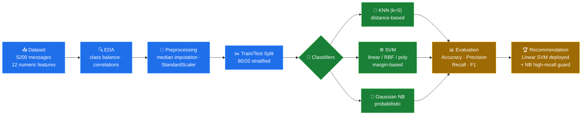
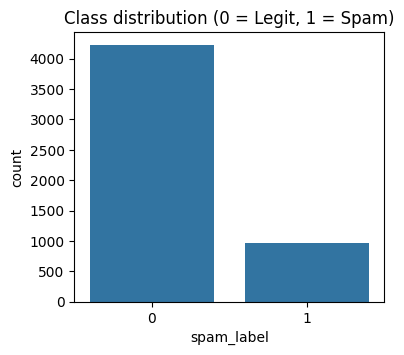
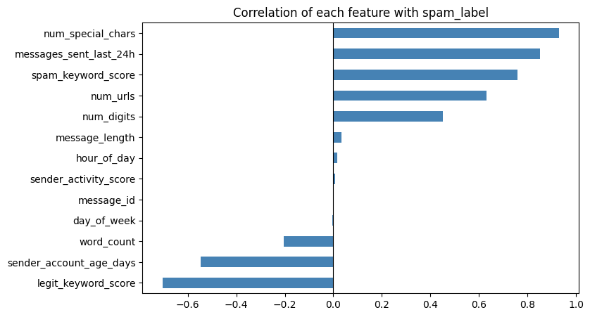
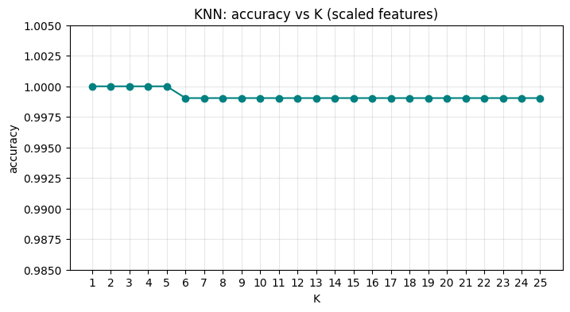
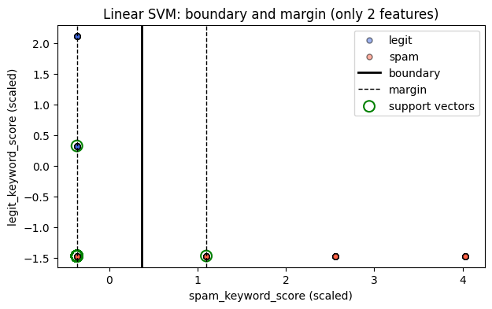
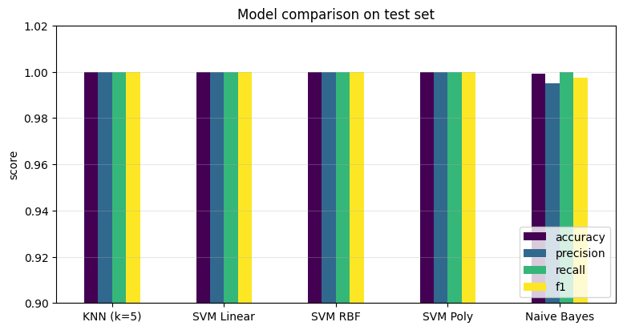
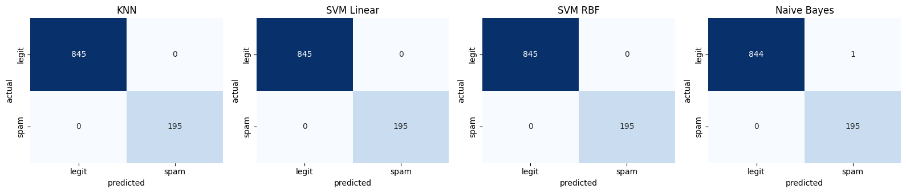
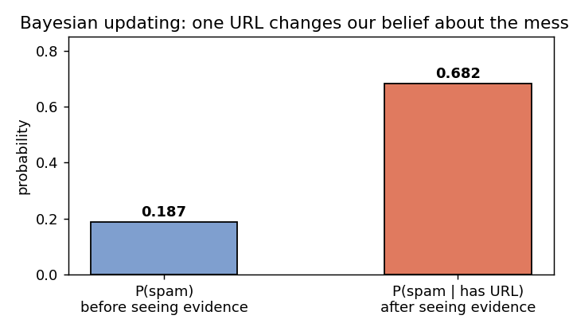
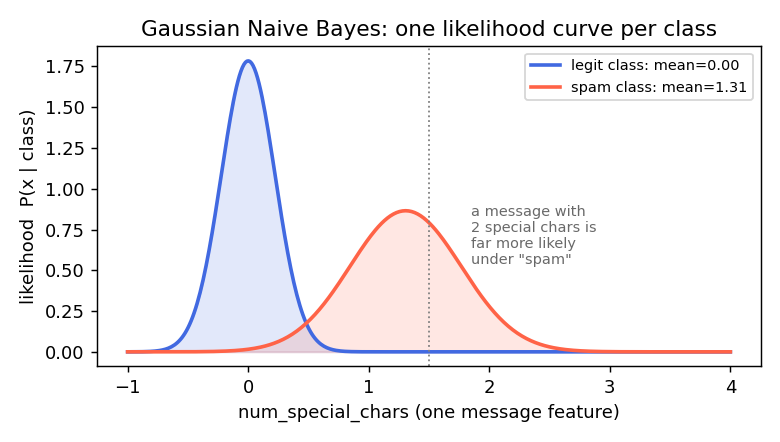

<p align="center">
  
</p>

<h1 align="center">📨 Message Intelligence System</h1>

<p align="center">
  <b>Classifying digital messages as <code>Spam (1)</code> or <code>Legitimate (0)</code> using Probability Theory + Machine Learning</b><br/>
  A 6-hour Data Science project comparing <b>distance-based (KNN)</b>, <b>margin-based (SVM)</b> and <b>probabilistic (Naive Bayes)</b> classifiers.
</p>

<!-- ▶️ ACTION: replace VIDEO_URL below with the link to your video explanation -->
<p align="center">
  <a href="Message_Intelligence_System.ipynb"></a>
  <a href="Message_Intelligence_System.py"></a>
  <a href="Project_Questions.md"></a>
  <a href="Theory_Concepts_Message_Intelligence.pdf"></a>
  <a href="VIDEO_URL"></a>
</p>

<p align="center">
  
  
  
  
  
</p>

---

## 📖 Table of Contents

1. [🎯 Project Objective & the Big Picture](#-project-objective--the-big-picture)
2. [🧠 How the System "Thinks"](#-how-the-system-thinks)
3. [🗂️ Repository Structure](#️-repository-structure)
4. [🔄 Project Pipeline](#-project-pipeline)
5. [📊 Dataset Deep Dive](#-dataset-deep-dive)
6. [🧮 Theory Explained Simply](#-theory-explained-simply)
7. [🧩 The Three Classifier Families](#-the-three-classifier-families)
8. [🔬 Experiments & Results](#-experiments--results)
9. [📸 Output Gallery](#-output-gallery)
10. [✅ Assignment Coverage](#-assignment-coverage)
11. [🚀 How to Run](#-how-to-run)
12. [🔮 Future Improvements](#-future-improvements)
13. [💡 What I Learned](#-what-i-learned)
14. [👩‍💻 Author](#-author)

---

## 🎯 Project Objective & the Big Picture

Every day, billions of messages move through email, SMS and chat apps — and deciding *"should the user see this, or is it spam?"* has to happen in milliseconds, automatically. This project builds exactly that decision engine from scratch, but with a special focus:

> **Not just** "does it classify correctly", but **"why"** — can we explain every prediction using probability theory?

**📑 The scenario (from the assignment):** You are a **Data Scientist** at a communication security company. The company wants a **Message Intelligence System** that reads an incoming message and instantly labels it:

| Label | Meaning | Business risk if wrong |
|:---:|:---|:---|
| `0` | ✅ Legitimate message | Client loses an important mail (false alarm) |
| `1` | 🚫 Spam message | A scam/phishing mail reaches the user (missed threat) |

**🎓 Learning goals covered:**

- Combine **probability theory** (conditional probability, Bayes' theorem) with real ML models
- Compare three classifier "philosophies" — **distance-based** (KNN), **margin-based** (SVM), **probabilistic** (Naive Bayes)
- Analyze how each model's built-in **assumptions** change its real-world behaviour
- Answer all **24 project questions (Parts A–G)** in a fully reproducible, executed notebook

---

## 🧠 How the System "Thinks"

A human reads a message and *feels* it's spam. A machine can't read — so the raw text is first converted into **12 numeric measurements**, and the models decide using only those numbers. Watch one real example from the dataset:

> ✉️ *"Earn money from home instantly instant cashback limited time! https://tinyurl.com/8577"*

| Step | What happens | Value |
|:---:|:---|:---|
| 1️⃣ | Count characters / words | length = 68, words = 10 |
| 2️⃣ | Count suspicious items | URLs = 1, special chars = 2, digits = 4 |
| 3️⃣ | Keyword scan | spam_keyword_score = 2, legit_keyword_score = 0 |
| 4️⃣ | Sender profile | sends ~20 msgs/day, account fairly new |
| 5️⃣ | **Model decision** | 🚫 **SPAM** (probability ≈ 1.00) |

A legit colleague's message — e.g. *"Can you send the report by end of day? Please confirm."* — gives the opposite pattern: 0 URLs, 0 special chars, 0 spam keywords, high legit keyword score, old quiet sender account → ✅ **LEGIT**.

The three model families differ only in **how they combine these 12 numbers into a verdict** — and that difference is the whole point of this project. 👇

---

## 🗂️ Repository Structure

| 📁 File / Folder | 📌 What it contains |
|:---|:---|
| 📓 [`Message_Intelligence_System.ipynb`](Message_Intelligence_System.ipynb) | Main notebook — **theory answers + code + plots + final report**, all cells executed |
| 🐍 [`Message_Intelligence_System.py`](Message_Intelligence_System.py) | Same project as a pure Python script |
| ❓ [`Project_Questions.md`](Project_Questions.md) | All 24 project questions, typed out |
| 📄 [`Theory_Concepts_Message_Intelligence.pdf`](Theory_Concepts_Message_Intelligence.pdf) | 11-page theory document — definitions, formulas, diagrams & analysis |
| 🧾 [`Message_Intelligence_Dataset_5200.csv`](Message_Intelligence_Dataset_5200.csv) | Dataset — 5200 messages × 16 columns |
| 📦 [`requirements.txt`](requirements.txt) | One-line install for all dependencies |
| 🖼️ [`images/`](images/) | Graphs generated by the project (used below) |
| 🎞️ [`assets/`](assets/) | Header & footer animations |
| 🛠️ [`scripts/`](scripts/) | Helpers that regenerate the theory PDF, its figures & the GIF banners |

---

## 🔄 Project Pipeline



**How to read it:** raw data first gets explored (EDA), then cleaned (missing values + scaling), then frozen into a fair 80/20 train/test split. Three different model *families* learn from **the exact same training data**, so their comparison later is apples-to-apples. Every verdict is measured with 4 metrics, and the best trade-off becomes the deployment recommendation.

---

## 📊 Dataset Deep Dive

**5200 messages**, each compressed into 12 numeric features + the answer column `spam_label`:

| Feature group | Columns | Intuition — what the model is "sensing" |
|:---|:---|:---|
| ✍️ Message shape | `message_length`, `word_count`, `num_digits`, `num_special_chars` | Spam is often heavy on **₹, !, %, \$** symbols and phone-like digit strings |
| 🔗 Links | `num_urls` | A bare URL with no context is a classic spam fingerprint |
| 🔑 Keywords | `spam_keyword_score`, `legit_keyword_score` | *"free, cash, prize, limited time"* vs *"meeting, report, invoice"* |
| 👤 Sender profile | `sender_activity_score`, `sender_account_age_days`, `messages_sent_last_24h` | Brand-new accounts blasting 40 messages/day ≈ spam farms |
| 🕐 Timing | `hour_of_day`, `day_of_week` | (turned out almost useless here — see below!) |
| 🎯 **Target** | **`spam_label`** | 0 = legit, 1 = spam — what we learn to predict |

### ⚠️ Data issues found & fixed (real-world stuff!)

| Issue | Size | Fix applied |
|:---|:---:|:---|
| 🕳️ Missing values in `sender_activity_score` | 106 rows | filled with column **median** (robust to outliers) |
| 🕳️ Missing values in `sender_account_age_days` | 113 rows | filled with median |
| 🕳️ Missing values in `messages_sent_last_24h` | 162 rows | filled with median |
| ⚖️ Imbalanced classes (81.3% legit / 18.7% spam) | 4227 / 973 | **stratified** split + look beyond accuracy |
| 📏 Huge scale differences between features | range ≈1000 vs ≈4 | **StandardScaler** for KNN & SVM |

### 🔗 Correlations — which features carry the signal?

`num_special_chars` (0.93) and `messages_sent_last_24h` (0.85) correlate with spam so strongly that they nearly give the answer away; `spam_keyword_score` (0.76) and `num_urls` (0.63) help too. On the flip side, `legit_keyword_score` (−0.70) and old accounts (−0.55) point away from spam. Surprisingly, `hour_of_day` and `day_of_week` correlate ≈0 — **timing turned out useless** here (honest ML: not every feature matters!). Also note `message_length` ↔ `word_count` are correlated with *each other* — remember this, it becomes the villain in the Naive Bayes discussion. 😉

<p align="center">
  &nbsp;&nbsp;&nbsp;
  
</p>

---

## 🧮 Theory Explained Simply

> 📄 Deep version with diagrams, derivations and project analysis: [`Theory_Concepts_Message_Intelligence.pdf`](Theory_Concepts_Message_Intelligence.pdf)

### 1️⃣ Conditional Probability — "given what I know, how likely is it?"

Normal probability asks *"how likely is spam?"* Conditional probability asks *"how likely is spam, **now that I know** it contains a URL?"* — the extra clue shrinks the world to only the cases that match:

$$P(A \mid B) = \frac{P(A \cap B)}{P(B)}$$

**Counted straight from our training data (4160 messages):**

$$P(\text{spam})=0.187 \quad \text{but} \quad P(\text{spam} \mid \text{has URL})=\frac{579}{849}=0.682$$

One clue — "has a URL" — **quadrupled** the suspicion. A classifier is basically this idea, applied to *all 12 clues at once*.

### 2️⃣ Bayes' Theorem — flipping the question

Data is easy to count *per class* ("among spam, how many have URLs?"). But we need the *reverse* ("given URLs, is it spam?"). Bayes' theorem does the flip:

$$P(A \mid B) = \frac{P(B \mid A)\,P(A)}{P(B)} = \underbrace{P(\text{prior})}_{\text{old belief}} \times \underbrace{P(\text{likelihood})}_{\text{evidence fit}} / P(\text{evidence}) \rightarrow \underbrace{P(\text{posterior})}_{\text{new belief}}$$

**Verified both ways on our data** — direct counting and Bayes' formula agree:

$$\frac{P(\text{URL}\mid\text{spam})\,P(\text{spam})}{P(\text{URL})} = \frac{0.744 \times 0.187}{0.204} = 0.682 \;=\; P(\text{spam}\mid\text{URL})\ ✓$$

The classifier's golden rule is then the **MAP rule**: pick whichever class has the bigger posterior — $\hat{y}=\arg\max_c P(x \mid c)P(c)$.

### 3️⃣ Naive Bayes — Bayes with a (useful) fib

Computing the joint likelihood of 12 features needs $2^{12}$ combinations — impossible. Naive Bayes "lies" and declares all features **independent given the class**, turning one impossible question into 12 easy ones (a per-feature bell curve):

$$P(c \mid x) \propto P(c)\prod_{i=1}^{12} \underbrace{\frac{1}{\sqrt{2\pi\sigma_{i,c}^{2}}}\exp\!\left(-\frac{(x_i-\mu_{i,c})^{2}}{2\sigma_{i,c}^{2}}\right)}_{\text{Gaussian PDF of feature } i \text{ in class } c}$$

The fib *is* false here (our features are correlated — remember `message_length` ↔ `word_count`), and its visible symptom was **over-confident probabilities** (0.0000 / 1.0000 everywhere) plus exactly **1 false positive**. But the *ranking* stayed right → **99.9% accuracy, recall = 1.000**. NB doesn't even need feature scaling, trains in ~2 ms, and its whole "brain" is 2 priors + 12 means + 12 variances. ✨

### 4️⃣ K-Nearest Neighbors — "you are your neighbors"

Store every training message. For a new message, find the **K most similar** ones (smallest distance in the 12-D feature space) and let them **vote**:

$$\text{Euclidean: } d=\sqrt{\sum_i (x_i - z_i)^2} \qquad \text{Manhattan: } d=\sum_i |x_i - z_i|$$

- **K too small** (1) → memorizes noise (overfitting)
- **K too big** (21+) → neighbourhood floods with the other class near the border (underfitting)
- **No training phase at all** — all work happens at prediction time ("lazy learner")
- **Distances are scale-sensitive** — this caused our biggest experiment result (see §Experiments!)

### 5️⃣ Support Vector Machine — "leave the widest road between the classes"

Instead of any separating line, SVM finds the one with the **maximum margin** (empty road) on both sides. Only the few points *touching* the road edges — the **support vectors** — decide anything:

$$w^{T}x + b = 0 \quad\text{(boundary)}, \qquad \text{margin width} = \frac{2}{\lVert w \rVert} \;\;\rightarrow\; \max$$

**Kernel trick:** data that needs a curved boundary gets silently lifted into a higher dimension where a flat hyperplane suffices:

| Kernel | Intuition | In our data |
|:---|:---|:---|
| Linear | straight boundary | ✅ enough — classes nearly separable |
| Polynomial (deg 3) | smooth curves | 100% but unneeded complexity |
| RBF (Gaussian) | local, flexible bumps | 100% but used **138 support vectors** vs linear's **10** |

### 6️⃣ Evaluation — because accuracy can lie to your face

If I label *everything* "legit" on this dataset, I score **81.3% accuracy while catching ZERO spam**. Useless! So we unpack the confusion matrix:

| | Predicted Legit | Predicted Spam |
|:---|:---:|:---:|
| **Actual Legit** | TN ✅ kept | **FP** 😡 false alarm (lost invoice!) |
| **Actual Spam** | **FN** 😱 scam got through | TP ✅ caught |

$$\text{Precision}=\frac{TP}{TP+FP} \;\;(\text{"when I shout SPAM, am I right?"})\qquad \text{Recall}=\frac{TP}{TP+FN}\;\; (\text{"of all spam, how much did I catch?"})$$

$$\text{Accuracy}=\frac{TP+TN}{\text{all}}\qquad F_1 = \frac{2 \cdot \text{Prec}\cdot\text{Rec}}{\text{Prec}+\text{Rec}}$$

**The trade-off is a business decision:** an email filter must protect precision (never eat a legit mail), a security scanner must protect recall (never miss a scam). Our final report recommends exactly this dual setup — SVM for precision + NB as high-recall quarantine guard.

---

## 🧩 The Three Classifier Families

Each family is a different personality — same data, same verdicts, totally different *reasoning*:

| Aspect | 📏 Distance-based (KNN) | 🎲 Probabilistic (Naive Bayes) | ⚙️ Margin-based (SVM) |
|:---|:---|:---|:---|
| Decision style | *"What did similar past messages turn out to be?"* | *"Which class makes this evidence most probable?"* | *"Which side of the widest road are you on?"* |
| Remembers | every training message | 2 priors + means + variances | hyperplane weights / support vectors |
| Math behind it | geometry & voting | Bayes' theorem + independence | optimisation (max margin) |
| Needs scaling | ✅ critical — else features with big numbers dominate | ❌ no — features modelled separately | ✅ recommended |
| Training / prediction | instant train, **slow** predict | fast both | fast predict (uses only SVs) |
| Gives probabilities | rough (vote fraction) | yes — but **over-confident** here | no (distance to boundary instead) |
| Achilles' heel | slow at scale, hates unscaled/irrelevant features | correlated features break its honesty | kernel & C tuning, less interpretable |
| Shines when | patterns are local, dataset moderate | many features, need speed + baseline | classes separable, need robustness |

---

## 🔬 Experiments & Results

### 🏆 Final scoreboard (test set: 1040 unseen messages)

| 🤖 Model | Accuracy | Precision | Recall | F1 | 💡 Note |
|:---|:---:|:---:|:---:|:---:|:---|
| KNN (k=5, **scaled**) | **1.000** | **1.000** | **1.000** | **1.000** | perfect after scaling |
| KNN (k=5, unscaled) | 0.968 | 0.950 | 0.877 | 0.912 | ❌ 33 errors — the scaling lesson |
| SVM Linear | **1.000** | **1.000** | **1.000** | **1.000** | only **10 support vectors** 🎯 |
| SVM RBF | **1.000** | **1.000** | **1.000** | **1.000** | 138 SVs — bends more than needed |
| Naive Bayes | 0.999 | 0.995 | **1.000** | 0.997 | 1 false positive, **caught ALL spam** |

**🥇 Business verdict:** deploy **Linear SVM** (accuracy + fastest prediction + tiniest memory), keep **Naive Bayes** as a high-recall guard: anything NB calls spam goes to *quarantine* instead of deletion.

### 🧪 Experiment 1 — How K changes KNN

Sweeping K = 1…25: **K ≤ 5 → 100%**, K ≥ 7 → dips to 99.9%. Big K smooths the boundary so much that legit points start voting spam. Chose **K = 5** (small enough for locality, big enough to resist noise).

### 🧪 Experiment 2 — The scaling plot twist 

**Same KNN, same data — only scaling ON/OFF:** 100% → 96.8% with **33 broken predictions** (24 sneak-through spam, 9 false alarms). Why? Euclidean distance sums per-feature gaps, so `sender_account_age_days` (range ~1000) screamed over `num_urls` (range ~4) and the small-but-mighty features went unheard. StandardScaler (fitted on **train only**, to avoid peeking at test data) restores fairness.

### 🧪 Experiment 3 — Do distance metrics matter?

After scaling: identical results (classes too well separated to care). **Unscaled**: Euclidean 0.968 / Manhattan 0.977 / Chebyshev 0.959 / Cosine 0.976 — metrics matter exactly when scales are messy. Lesson: fix your scaling first, *then* argue about metrics. 😄

### 🧪 Experiment 4 — Meeting the mistakes

The unscaled model's misses are textbook borderline cases:

> 🕵️ *"You've been selected for a cash prize of a brand new phone limited time!"* — spam with **no URL, almost no special chars** → looks legit to neighbours → **missed (FN)**
>
> 📎 *"Please find attached invoice… https://company.portal/docs/6283"* — a legit invoice **with a link** → looks spammy → **false alarm (FP)**

Even the scaled K=7 model missed exactly one: *"You are eligible for a refund of a brand new phone today only!"* — camouflaged spam sitting right at the class border.

### 🧪 Experiment 5 — SVM under the microscope

Linear SVM reached 100% using just **10 support vectors (5 + 5)** — the entire decision rule for 4160 training messages compressed into 10 edge cases. RBF matched the score but needed 138 SVs (unnecessary bending). On only the **2 most informative features**, a linear SVM still scored 94.4% with a crisp margin of 1/||w|| ≈ 0.73 — the plot below.

### 🧪 Experiment 6 — Verifying Bayes by hand ✍️

Recomputed posteriors for 3 test messages **by hand** with the Gaussian formula (log-space, using the model's own learned means/variances/priors): **identical to sklearn's `predict_proba`** down to the 4th decimal. The theory isn't a metaphor — it's literally the code.

---

## 📸 Output Gallery

<details open>
<summary><b>🤖 KNN — K tuning curve</b></summary>
<p align="center"></p>
<p align="center"><i>Accuracy vs K: flat at 100% for small K, gentle dip after K=7 as neighbourhoods cross the border.</i></p>
</details>

<details>
<summary><b>⚙️ SVM — boundary, margins & support vectors</b></summary>
<p align="center"></p>
<p align="center"><i>Linear SVM on the 2 strongest features: solid = boundary, dashed = margins, green rings = the support vectors.</i></p>
</details>

<details>
<summary><b>📊 Model comparison & confusion matrices</b></summary>
<p align="center">
  
  
</p>
<p align="center"><i>Scoreboard bars and per-model confusion matrices — spot NB's single false positive.</i></p>
</details>

<details>
<summary><b>🎲 Probability visuals</b></summary>
<p align="center">
  &nbsp;&nbsp;&nbsp;
  
</p>
<p align="center"><i>Left: evidence "has URL" lifts belief 0.187 → 0.682. Right: NB's per-class Gaussian likelihoods.</i></p>
</details>

---

## ✅ Assignment Coverage

| Part | Questions | Where it's answered |
|:---|:---:|:---|
| 🧠 A — Probability & theory | Q1–Q5 | Notebook markdown + 📄 Theory PDF §2–3 |
| 🧪 B — Dataset & preparation | Q6–Q8 | Notebook "Part B" |
| 📊 C — KNN | Q9–Q12 | Notebook "Part C" + Theory PDF §5 |
| ⚙️ D — SVM | Q13–Q15 | Notebook "Part D" + Theory PDF §6 |
| 🧮 E — Naive Bayes & probability | Q16–Q19 | Notebook "Part E" + Theory PDF §4 |
| 📈 F — Model comparison | Q20–Q22 | Notebook "Part F" + Theory PDF §8 |
| 📃 G — Final report | Q23–Q24 | Notebook "Part G" + Theory PDF §9 |

---

## 🚀 How to Run

```bash
# 1️⃣ clone the project
git clone https://github.com/DevanshiCodesAI/Message_Intelligence_System.git
cd Message_Intelligence_System

# 2️⃣ install dependencies
pip install -r requirements.txt

# 3️⃣ run the notebook (outputs are pre-computed too, so you can just read it)
jupyter notebook Message_Intelligence_System.ipynb

# ⏩ or run everything as a plain script
python Message_Intelligence_System.py
```

**The whole pipeline in ~15 lines of core code:**

```python
X = df[features].fillna(df[features].median())          # fix missing values (median)
y = df['spam_label']

# stratified 80/20 split keeps the 81/19 class ratio fair in both halves
X_train, X_test, y_train, y_test = train_test_split(
    X, y, test_size=0.2, random_state=42, stratify=y)

sc = StandardScaler()                                   # ⚠️ fit on TRAIN only — no peeking at test!
X_train_s = sc.fit_transform(X_train)
X_test_s  = sc.transform(X_test)

knn = KNeighborsClassifier(n_neighbors=5).fit(X_train_s, y_train)   # needs scaling
svm = SVC(kernel='linear', random_state=42).fit(X_train_s, y_train) # needs scaling
nb  = GaussianNB().fit(X_train.values, y_train)                     # scaling-free 🎉

# evaluate all 4 metrics the same way for a fair fight
def evaluate(name, pred):
    print(f"{name}: acc={accuracy_score(y_test, pred):.3f}  "
          f"prec={precision_score(y_test, pred):.3f}  "
          f"rec={recall_score(y_test, pred):.3f}  "
          f"f1={f1_score(y_test, pred):.3f}")

evaluate('KNN', knn.predict(X_test_s))
evaluate('SVM', svm.predict(X_test_s))
evaluate('NB',  nb.predict(X_test.values))
```

*(see `Message_Intelligence_System.ipynb` for the fully explained version with plots under every step)*

---

## 🔮 Future Improvements

| Idea | Why |
|:---|:---|
| 📝 TF-IDF / embeddings on raw `message_text` | We ignored the actual words; NLP would catch subtler spam |
| 🎯 Cross-validation + hyperparameter tuning (K, C, gamma) | Single split can flatter a model |
| 📏 Probability calibration (Platt scaling / isotonic) | NB's over-confident probabilities can't feed business rules safely yet |
| ⚖️ Cost-sensitive thresholds | Trade FP vs FN by shifting the SVM decision threshold |
| 📡 Drift monitoring & scheduled retraining | Spammers change behaviour; yesterday's boundary ages fast |

---

## 💡 What I Learned

1. 🧹 **Preprocessing is half the model** — one unscaled feature silently wrecked KNN until StandardScaler fixed the "volume" problem.
2. 🎲 **Probability theory isn't decoration** — Bayes' theorem was verified numerically two different ways, and its assumption failure was *visible* in NB's outputs.
3. 🥊 **A simpler model can win for real reasons** — Linear SVM beat RBF in elegance (10 vs 138 support vectors), speed and interpretability at equal accuracy.
4. 📊 **Accuracy alone is a trap** on imbalanced data — precision/recall tell the true story and map directly to business cost.
5. 🔍 **Reading the errors is worth more than the scoreboard** — the 33 mistakes revealed exactly what "hard" spam looks like.

---

## 👩‍💻 Author

<table>
  <tr>
    <td>👤 <b>Devanshi Bachhote</b></td>
    <td>🆔 GR ID: <b>10775</b></td>
    <td>🎓 Course: <b>AI ML and Data Science</b></td>
  </tr>
</table>

<p>
  <a href="https://github.com/DevanshiCodesAI"></a>
  <a href="https://github.com/DevanshiCodesAI/Message_Intelligence_System"></a>
</p>

---

<p align="center">
  
</p>
